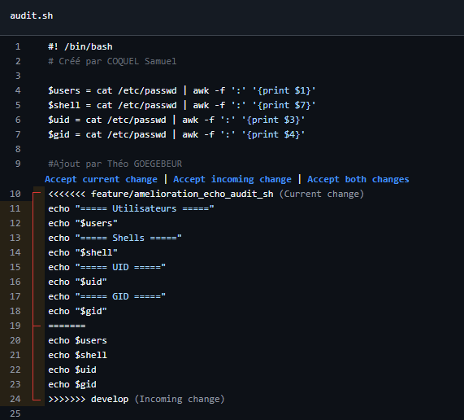

Nom Prénom Pseudonyme GitHub Rôle
GOEGEBEUR Théo @chill5959 Étudiant 2
COQUEL Samuel @samasam59 Étudiant 1
BERRADA Zakaria @TheZeKing Étudiant 3

Le conflit a eu lieu car une ligne a été modifié et lors du pull request, il a detecté un conflit car les deux lignes étaient différentes.
La solution a été de choisir la plus récente, qui était la plus propre. #Théo G

1. Quel est l’intérêt de séparer développements en cours et versions stables ?
Cela permet d'éviter lesimpacts sur la prod quand on fait des modifications. On peut travailler en autonomie sur la branche de dev. #Zakaria B

2. Pourquoi imposer une revue de code avant intégration ?
Pour éviter les erreurs de code qui pourraient impactés la prod. Cela sert également à avoir un second avis sur le script. #Samuel C

3. Quelles situations provoquent un conflit Git et pourquoi sa résolution n’est-elle pas toujours automatique ?
Le conflit est provoqué quand une ligne est modifié et que git ne sait plus laquelle est la plus récente, il nous faut donc lui préciser. #Théo G

4. Quelle différence entre correction classique et correction urgente de production ?
La correction classique va passer par la branche develop avant d'être envoyé en production tandis qu'un hotfix va être directement envoyé en prod. #Zakaria B

5. Pourquoi répercuter une correction de production dans les développements en cours ?
Pour qu'elle soit prise en compte sur les développements futurs et pour éviter qu'au prochain envoi en prod le bug revienne. #Zakaria B

6. Quel est le rôle d’une branche de release ?
La branche release a pour but de préparer une nouvelle version et donc de figer les modifications de la develop. #Samuel C

7. Comment GitHub Projects et les Issues facilitent-ils organisation et traçabilité ?
Github Porjects et Issues facilitent l'organisation en permettant de créer des objectifs avec une écheance et en permettant de définir un responsable ce qui délimite les taches.
La traçabilité est assuré par le fais que l'on peut associer une Issue à un ou plusieurs commits. #Théo G

8. Comment retrouver l’origine d’une modification dans l’historique GitHub ?
Soit via les extensions disponibles sur VScode ou avec la commande git log. #Samuel C